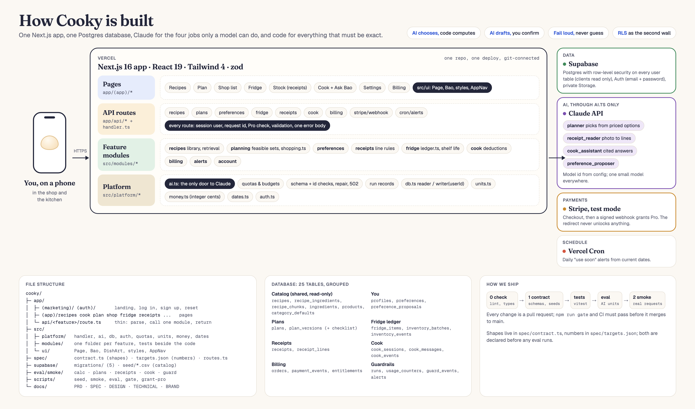

# Cooky

**Plan dinners from what is already in your fridge, buy exactly what the recipes need, and cook it before it goes off.**

**Live app: https://cooky-lake.vercel.app**

Cooky is a meal planner with a virtual fridge, built for people who cook for one or two and shop once a week. You plan a few dinners and get one shopping list rounded to real package sizes. Back home, you photograph the receipt and Cooky stocks the fridge, with a typical use-by date for every item. The fridge then shows what you can cook now, soonest-expiring food first, and cook mode answers questions from the recipe itself.

The AI does the reading: receipt lines, free-text wishes, cooking questions. Code does everything that must be exact: quantities, package counts, prices and dates. Nothing changes your fridge until you confirm it.

## Try it

1. Open https://cooky-lake.vercel.app and create an account.
2. Set up your household, budget and the foods you never eat.
3. **Unlock Pro** on the Billing page. Payments run in Stripe test mode, so use card `4242 4242 4242 4242` with any future expiry date and any CVC. Nothing is charged.
4. Plan three dinners, open the shopping list, then go to **Stock** and photograph a grocery receipt.
5. Open the fridge, pick a dish under **Cook now**, and ask Bao a question while you cook.

| | Free | Pro (US$4.99, test mode) |
|---|---|---|
| Recipe library, fridge, cook mode, Cook now | Yes | Yes |
| AI meal plans | 1 | 10 a day |
| Swap a meal | | 30 a day |
| Receipt scanning | | 5 a day |
| Cooking assistant | | 60 questions a day |
| Describe a dish to add a recipe | | 10 a day |

## Features

- **Plan.** Pick dishes yourself or let Cooky choose. Plans respect your budget, time per meal and the foods you never eat, and start from what is already in your fridge. If no plan fits, Cooky says which limit to relax instead of inventing one.
- **Shop.** One list merged across meals, in real package sizes, with the cost and what will be left over. Ticks are saved, so the list follows you from laptop to phone.
- **Stock.** Snap the receipt. Lines Cooky is sure of are accepted; the rest are flagged for you to check; items from the plan that are missing are pointed out. The photo is never stored.
- **Fridge.** Every item carries a typical use-by date with its source (USDA FoodKeeper). **Use soon** and **Cook now** rank what to make first.
- **Cook.** One step at a time, with timers. Bao, the assistant, answers only from the recipe and cites the step, or says the recipe does not cover your question.
- **Learn.** Rate a dish or leave a note; Cooky proposes a preference, and keeps it only if you choose to.

## Architecture



| Layer | Where | What it does |
|---|---|---|
| Pages | `app/(app)/`, `app/(auth)/`, `app/(marketing)/` | Next.js App Router screens, phone first |
| API | `app/api/<feature>/route.ts` | Thin routes: parse, call one module function, return |
| Request handler | `src/platform/handler.ts` | Session user, request id, validation against the contract, Pro check, one error body |
| Feature modules | `src/modules/<feature>/` | Domain logic with unit tests beside it |
| AI gateway | `src/platform/ai.ts` | The only code that calls Claude: quotas, spend cap, schema and id checks, repairs, run records |
| Data | Supabase Postgres | Row-level security on every user table; clients read, the server writes |
| Payments | Stripe Checkout (test mode) | A signed webhook grants Pro; the redirect never does |

**Four AI units, each one structured call on Claude Haiku 5.5:**

| Unit | The model | Code |
|---|---|---|
| `planner` | Picks one meal set and explains why | Finds and prices every feasible set first, so no choice can break a constraint |
| `receipt_reader` | Reads each line into an ingredient, quantity and confidence | Decides auto-accept or flag, converts units, computes use-by dates |
| `cook_assistant` | Answers from the recipe's retrieved steps, with citations | Retrieves the chunks; rejects citations outside them |
| `preference_proposer` | Turns "a bit dry" into a preference | Saves it only after you choose |

More: [design decisions and trade-offs](docs/DESIGN.md), the [full specification](docs/SPEC.md), and the [interface and brand](docs/BRAND.md).

## Tech stack

Next.js 16 (App Router, TypeScript), React 19, Tailwind CSS 4, zod · Supabase (Postgres, Auth, Storage) · Claude API (`@anthropic-ai/sdk`, Haiku 5.5) · Stripe Checkout in test mode · Vercel · Vitest and pgTAP.

## Run it locally

Needs Node 22 and Docker.

```bash
nvm use && npm install
npx supabase start                  # local Postgres, Auth and Storage
cp .env.example .env.local          # then paste the keys printed by the next command
npx supabase status -o env
npm run seed                        # recipes, ingredients, products, shelf life
npm run dev                         # http://localhost:3000
```

Without `ANTHROPIC_API_KEY`, every AI feature runs in fake mode with recorded fixtures, so you can use the whole app for free. To try Pro locally without Stripe: `npm run dev:grant-pro -- you@example.com`. Stripe, deploy and every environment variable: [docs/TECHNICAL.md](docs/TECHNICAL.md).

## Quality checks

```bash
npm run check            # lint, types, secret scan, live-key guard
npm run check:contract   # schemas compile; seed and eval sets validate
npm run test             # unit and module tests
npm run eval -- calc     # also: plans, cook
npm run gate -- --upto 2 --base-url http://localhost:3000   # everything above, plus smoke requests
```

Targets are declared in `spec/targets.json` before any run. Current results on `main`:

| Check | Target | Result |
|---|---|---|
| Shopping list matches hand-computed answers | 100% | 10 / 10 |
| Plans that respect every exclusion, allergen, budget and time limit | 100% | 8 / 8 |
| Impossible requests answered as infeasible | 100% | 2 / 2 |
| Cooking assistant retrieves the right step (recall@5) | 90% | 12 / 12 |
| Unit and database tests | all pass | 441 / 441 |

The planner eval runs on recorded fixtures by default; set `ANTHROPIC_API_KEY` for a live run. The receipt-accuracy set is not labelled yet.

## Repository layout

```
app/              pages and API routes
src/platform/     request handler, AI gateway, database clients, money, units, dates
src/modules/      recipes, planning, preferences, receipts, fridge, cook, billing, alerts
src/ui/           the shared design system: Page, Bao, styles
spec/             contract.ts (API shapes) and targets.json (every number)
supabase/         migrations, seed CSVs, database tests
eval/             eval sets and rules
scripts/          seed, smoke, eval, gate
docs/             PRD, SPEC, DESIGN, TECHNICAL, BRAND
```

## Contributing

Every change goes through a pull request from a branch named `<area>/<topic>`, and the gate must pass before it merges. [AGENTS.md](AGENTS.md) holds the rules for contributors and coding agents: module boundaries, the contract, and the requirements every AI feature must meet.

## Limits

Payments are Stripe test mode only, prices are a dated snapshot from one store, shelf-life dates are a typical storage guide and not a food-safety check, and Cooky never certifies a dish as allergen-free.
